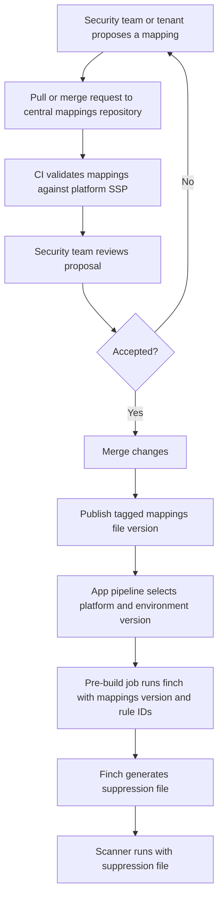

# Plan

This document records decisions and open items for a new implementation of `finch`. Use it with the [glossary](GLOSSARY.md) to guide implementation. Do not start implementation until the code owner approves both documents. Flag conflicts in settled decisions.

**Approval Status**

* [x] [Glossary](GLOSSARY.md)
* [ ] Plan

## Background

A [hosting platform](GLOSSARY.md) has an Authority to Operate (ATO) and a [system security plan](GLOSSARY.md) (SSP). An app seeking deployment to multiple [hosting platforms](GLOSSARY.md) must obtain approval from each one and run a separate scan for each platform.

The [security team](GLOSSARY.md) uses `finch` to maintain [mappings files](GLOSSARY.md) and generate [suppressions](GLOSSARY.md). A [tenant](GLOSSARY.md) or [security team](GLOSSARY.md) can propose a mapping by pull request or merge request. The [security team](GLOSSARY.md) reviews the proposal and decides whether to accept it. The [platform team](GLOSSARY.md) implements the platform and helps apps integrate with it.

One central repository holds the [mappings files](GLOSSARY.md), with a folder for each platform. A [mappings file version](GLOSSARY.md) applies to one [environment](GLOSSARY.md) of one [hosting platform](GLOSSARY.md). A version uses a prefixed Git tag such as `platform-a/prod/v1.2.0`.

The new implementation uses Go and first supports the [scanner](GLOSSARY.md) ZAP. It does not need to be compatible with the existing code or mappings.

## Workflow

The diagram shows the intended flow. The source of rule IDs and the way a pipeline selects a newly published version remain open.



## Data Models

Target OSCAL 1.2.3 with [go-oscal](https://github.com/defenseunicorns/go-oscal). Stay close to the OSCAL specification. Do not invent structure that breaks validation.

The [mappings file](GLOSSARY.md) is an OSCAL component definition. The placement below is the working choice. Confirm it against the OSCAL version in use and run the official validator over a sample file before relying on it. Custom namespaced props are the specification's extension point.

| Field | Candidate location | Rule |
| --- | --- | --- |
| [component](GLOSSARY.md) | [component](GLOSSARY.md) in the component definition | Must already exist in the [SSP](GLOSSARY.md) |
| [control](GLOSSARY.md) | `control-id` on an implemented requirement | Must exist in the [SSP](GLOSSARY.md) and be marked implemented, not planned or partial |
| [scanner](GLOSSARY.md) rule | Custom namespaced prop on the implemented requirement | Must exist in the [scanner's](GLOSSARY.md) rule set |
| Reason | `remarks` | The submitter's own words, stored verbatim, never rewritten by `finch` or an agent |
| [SSP](GLOSSARY.md) evidence | A link to the [control](GLOSSARY.md) in the [SSP](GLOSSARY.md) | A reference, not copied text |
| [SSP](GLOSSARY.md) version | Reference to the [SSP](GLOSSARY.md) version used to assess the mappings | Must match the [SSP](GLOSSARY.md) provided for validation |
| Expiry | Custom namespaced prop holding `YYYY-MM-DD` | UTC, inclusive, never later than the ATO expiration date |
| UUIDs | Generated by `finch` | Derived deterministically from rule, [component](GLOSSARY.md), and [control](GLOSSARY.md), so the same inputs do not change the file |

The [security team](GLOSSARY.md) must confirm that the [component](GLOSSARY.md) supports the [control](GLOSSARY.md) and that the [control](GLOSSARY.md) mitigates the [risk](GLOSSARY.md) associated with the rule across its scope in the target [context](GLOSSARY.md). `finch` does not assess these relationships.

## Architecture

Build one binary with shared core functions and thin surfaces. The local MCP server runs from the same binary. There is no separate server application or GUI. All surfaces use the same validation rules.

The `--mode` flag selects `cli` (default), `tui`, or `mcp`. CLI commands take parameters directly. The TUI form and MCP tools supply the same parameters through their respective surfaces.

* Core functions read an [SSP](GLOSSARY.md) and [mappings file](GLOSSARY.md), build mappings, validate a file, and generate [suppressions](GLOSSARY.md).
* CLI and TUI mapping operations write the updated file to disk.
* MCP mapping operations return the complete updated file. They do not return a diff, write to the repository, or commit. The same inputs produce the same file.
* The central repository's CI validates the relevant [mappings file](GLOSSARY.md) against its platform's current [SSP](GLOSSARY.md).
* An app pipeline runs `create suppression` in a pre-build job before the [scanner](GLOSSARY.md).

The following CLI names and parameters describe the intended interface. Parameter names remain open.

```text
finch create component --ssp ssp.json --component <name> --mappings mappings.json
finch map control --ssp ssp.json --mappings mappings.json --component <name> --control <id>
finch map rule --ssp ssp.json --mappings mappings.json --component <name> --control <id> --rule zap:<id> --reason "<text>" --expiry YYYY-MM-DD
finch validate --ssp ssp.json --mappings mappings.json
finch create suppression --mappings <repo-path> --mappings-file-version <platform>/<environment>/<version> --scanner zap --rule <id> [--rule <id> ...]
```

The repeated `--rule` syntax illustrates multiple IDs; the final syntax is open. There is no separate export command.

## Features

### Create component and map

`create component` reads the [SSP](GLOSSARY.md) and adds a [component](GLOSSARY.md) to the [mappings file](GLOSSARY.md). Its exact scaffolding is open. `map control` associates an implemented [control](GLOSSARY.md) with a [component](GLOSSARY.md). `map rule` associates a [scanner](GLOSSARY.md) rule, reason, and expiry with that [control](GLOSSARY.md) and [component](GLOSSARY.md).

For `map rule`:

* Fail with a message naming the check if the [component](GLOSSARY.md) is missing from the [SSP](GLOSSARY.md), the [control](GLOSSARY.md) is missing or not marked implemented, the rule is not in the [scanner's](GLOSSARY.md) rule set, the reason is empty, or the expiry is unparseable or already past.
* If the requested expiry is later than the ATO expiration date, cap it at that date and say so in the response.
* Preserve the reason verbatim. The same inputs produce the same file.

### Validate

Run the checks over the whole [mappings file](GLOSSARY.md) against the current [SSP](GLOSSARY.md). Reject missing required fields and references that do not resolve, including a removed [component](GLOSSARY.md) or a [control](GLOSSARY.md) that is no longer implemented. Warn about expired mappings without failing validation.

Fail if the provided [SSP](GLOSSARY.md) version differs from the version recorded in the [mappings file](GLOSSARY.md). Report both versions so the [security team](GLOSSARY.md) can review the mappings. `finch` cannot determine whether changes to the [SSP](GLOSSARY.md) affect the validity of a mapping.

### Create suppression

An app's CI pipeline runs this step before the [scanner](GLOSSARY.md), using a tagged [mappings file version](GLOSSARY.md) for its target platform and [environment](GLOSSARY.md). It supplies one or more rule IDs and the [scanner](GLOSSARY.md). `finch` reads the selected [mappings file](GLOSSARY.md), not the [SSP](GLOSSARY.md), and generates the appropriate [suppression](GLOSSARY.md) file for the supplied rules.

* Use only the selected platform's mappings. Do not combine platforms.
* Emit a [suppression](GLOSSARY.md) only for a supplied rule with an explicit, valid mapping.
* Compare each mapping's expiry to the current UTC date. A mapping is valid through its expiry date. Omit expired mappings without failing or warning.
* Include a comment naming the platform, [mappings file version](GLOSSARY.md), reason, and expiry for each valid mapping, subject to the selected output format.
* Use deterministic output and no LLM.

## Open Items

* How does the pre-build job obtain the rule IDs before the scan?
* How does a pipeline select a newly published [mappings file version](GLOSSARY.md), and how does `finch` locate its file from the tag?
* What ZAP [suppression](GLOSSARY.md) format works with the quick scan wrapper, and how does the pipeline consume it?
* When several valid mappings name one rule, should output contain one [suppression](GLOSSARY.md) with multiple reasons or one per mapping?
* What should the exit code be when no supplied rule has a valid mapping?
* Should `finch` produce a separate audit record of the version and reasons used, or are comments in the output sufficient?
* What should `create component` scaffold from the [SSP](GLOSSARY.md)?
* Where do the ATO expiration date and ZAP rule set come from? Should validation reject expiries past the ATO expiration date?
* Do inherited [controls](GLOSSARY.md) count as implemented?
* What happens to Semgrep rules in the legacy mappings, given that ZAP is first in scope?
