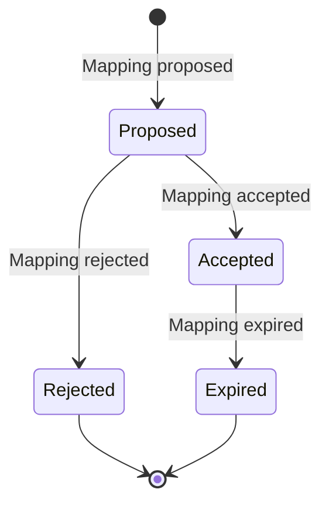
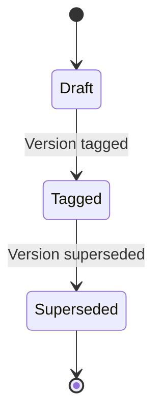
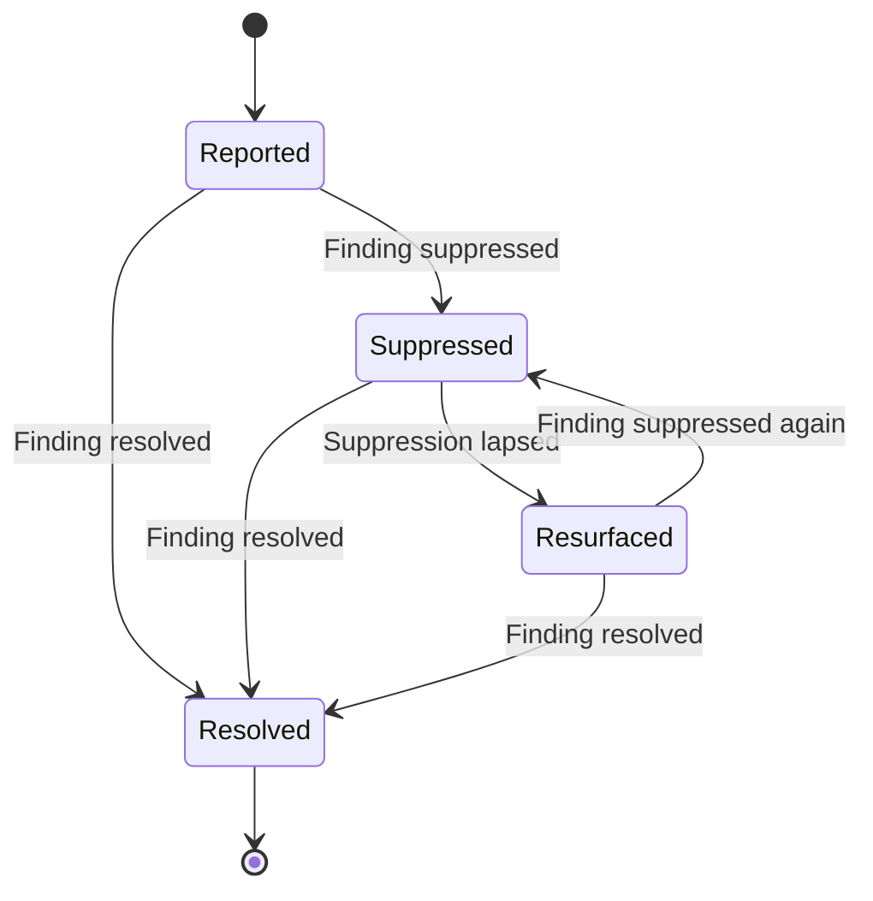

# State Machines
 
This file describes how things in Finch change over time. [GLOSSARY.md](GLOSSARY.md) defines what things are; this file defines the stages they pass through, who moves them between stages, and why.
 
A lifecycle is the set of business states an entity moves through. Each lifecycle has one owner (the entity that moves), a fixed set of states, and named transitions. Transitions are written as past-tense events, the way a domain expert would report them.
 
Status of this draft: states, guards, and rules below are inferred from the [glossary](GLOSSARY.md). Items marked "Ask" are questions for the domain experts and should be resolved before this file is treated as authoritative.
 
Contents:
 
- [Mapping](#mapping)
- [Mappings file version](#mappings-file-version)
- [Finding](#finding)
- [Rules that span lifecycles](#rules-that-span-lifecycles)
---
 
## Mapping

Finch does not yet model Proposed, Accepted, or Rejected. Code derives Expired from the [expiry](GLOSSARY.md#expiry) and the supplied date. The remaining section describes the target design.
 
Owner: [mapping](GLOSSARY.md#mapping)
 
Context: reviewing whether an implemented [control](GLOSSARY.md#control) justifies ignoring a [scanner](GLOSSARY.md#scanner) rule for a [component](GLOSSARY.md#component).
 
Also known as: (Ask: do experts say "status", "approval", or "exception" for this?)
 
### States
 
| State | What is true in this state |
| --- | --- |
| Proposed | A [mapping](GLOSSARY.md#mapping) has been written with a [justification](GLOSSARY.md#justification) and an [expiry](GLOSSARY.md#expiry). The [security team](GLOSSARY.md#security-team) has not decided yet. |
| Accepted | The [security team](GLOSSARY.md#security-team) agrees the [control](GLOSSARY.md#control) mitigates the [risk](GLOSSARY.md#risk). Finch may generate a [suppression](GLOSSARY.md#suppression) from it. |
| Rejected | The [security team](GLOSSARY.md#security-team) declined it. No [suppression](GLOSSARY.md#suppression) is generated. Terminal. |
| Expired | The [expiry](GLOSSARY.md#expiry) date has passed. Finch no longer generates a [suppression](GLOSSARY.md#suppression) from it. Terminal. |
 
Initial state: Proposed
 
Terminal states: Rejected, Expired
 
### Transitions
 
| Event | From | To | Triggered by | Guard | Why it matters |
| --- | --- | --- | --- | --- | --- |
| Mapping proposed | (none) | Proposed | [Tenant](GLOSSARY.md#tenant) or [platform team](GLOSSARY.md#platform-team) | Has a [justification](GLOSSARY.md#justification) and an [expiry](GLOSSARY.md#expiry) in the future | A [mapping](GLOSSARY.md#mapping) without a reason or an end date cannot be reviewed or audited. |
| Mapping accepted | Proposed | Accepted | [Security team](GLOSSARY.md#security-team) | Reviewer is not the proposer (Ask) | The [security team](GLOSSARY.md#security-team) decides whether an app may be deployed, so only it can approve. |
| Mapping rejected | Proposed | Rejected | [Security team](GLOSSARY.md#security-team) | A reason is recorded (Ask) | A recorded reason lets the proposer fix and resubmit. |
| Mapping expired | Accepted | Expired | Time | [Expiry](GLOSSARY.md#expiry) date has passed | Acceptance is temporary. The [risk](GLOSSARY.md#risk) must be re-reviewed periodically. |
 
### Forbidden moves
 
- Proposed to Expired. A [mapping](GLOSSARY.md#mapping) that was never accepted never became valid, so it has nothing to expire. Ask: or does an unreviewed proposal also lapse?
- Rejected to Accepted. A rejection is final. Resubmission is a new [mapping](GLOSSARY.md#mapping), so the history of the decision is preserved.
- Expired to Accepted. Renewal is a new [mapping](GLOSSARY.md#mapping) with a fresh [justification](GLOSSARY.md#justification) and [expiry](GLOSSARY.md#expiry). Ask: can a renewal reuse the old [justification](GLOSSARY.md#justification)?
### Time-based rules
 
- An accepted [mapping](GLOSSARY.md#mapping) expires at the end of its [expiry](GLOSSARY.md#expiry) date. Ask: is the date inclusive, and in which time zone?
### Open questions
 
- Can the [security team](GLOSSARY.md#security-team) revoke an accepted [mapping](GLOSSARY.md#mapping) before its [expiry](GLOSSARY.md#expiry)? If so, add a Revoked state.
- Is there a maximum allowed [expiry](GLOSSARY.md#expiry) interval?
- If a [component](GLOSSARY.md#component) is removed from an [environment](GLOSSARY.md#environment), what happens to its accepted [mappings](GLOSSARY.md#mapping)?
### Diagram
 

 
---
 
## Mappings file version
 
Owner: [mappings file version](GLOSSARY.md#mappings-file-version)
 
Context: releasing a set of [mappings](GLOSSARY.md#mapping) for one [environment](GLOSSARY.md#environment) of one [hosting platform](GLOSSARY.md#hosting-platform).
 
### States
 
| State | What is true in this state |
| --- | --- |
| Draft | The [mappings file](GLOSSARY.md#mappings-file) is being edited. It may contain [mappings](GLOSSARY.md#mapping) that are still Proposed. |
| Tagged | The version is fixed. Finch can use it to generate [suppressions](GLOSSARY.md#suppression). It does not change. |
| Superseded | A newer tagged version exists for the same [environment](GLOSSARY.md#environment). Kept for history. Terminal. |
 
Initial state: Draft
 
Terminal states: Superseded
 
### Transitions
 
| Event | From | To | Triggered by | Guard | Why it matters |
| --- | --- | --- | --- | --- | --- |
| Version tagged | Draft | Tagged | [Security team](GLOSSARY.md#security-team) (Ask) | Contains only Accepted [mappings](GLOSSARY.md#mapping) (Ask) | A tag is a promise that the contents were reviewed. |
| Version superseded | Tagged | Superseded | A newer version being tagged | Same [environment](GLOSSARY.md#environment) and [hosting platform](GLOSSARY.md#hosting-platform) | [Components](GLOSSARY.md#component) and [controls](GLOSSARY.md#control) differ between [environments](GLOSSARY.md#environment), so versions are never compared across them. |
 
### Forbidden moves
 
- Tagged to Draft. A tagged version is immutable. Changes go in a new version.
### Open questions
 
- Does Finch ever use more than one tagged version at once, for example during a rollout?
- Are [mappings](GLOSSARY.md#mapping) that expire while a version is Tagged left in place, or does the version stay valid and Finch skip them?
### Diagram
 

 
---
 
## Finding
 
Owner: [finding](GLOSSARY.md#finding)
 
Context: what happens to a result reported by a [scanner](GLOSSARY.md#scanner) once [mappings](GLOSSARY.md#mapping) are applied.
 
### States
 
| State | What is true in this state |
| --- | --- |
| Reported | A [scanner](GLOSSARY.md#scanner) has reported the [finding](GLOSSARY.md#finding). No Accepted [mapping](GLOSSARY.md#mapping) covers it. |
| Suppressed | An Accepted [mapping](GLOSSARY.md#mapping) covers it, so a [suppression](GLOSSARY.md#suppression) tells the [scanner](GLOSSARY.md#scanner) to ignore it. |
| Resurfaced | It was Suppressed, but the [mapping](GLOSSARY.md#mapping) expired, so the [scanner](GLOSSARY.md#scanner) reports it again. |
| Resolved | The underlying issue is gone, for example the [tenant](GLOSSARY.md#tenant) fixed the app or removed the feature ([risk avoidance](GLOSSARY.md#risk-avoidance)). Terminal. |
 
Initial state: Reported
 
Terminal states: Resolved
 
### Transitions
 
| Event | From | To | Triggered by | Guard | Why it matters |
| --- | --- | --- | --- | --- | --- |
| Finding suppressed | Reported | Suppressed | Finch | A matching [mapping](GLOSSARY.md#mapping) is Accepted and not Expired | A [suppression](GLOSSARY.md#suppression) is only valid while the reasoning behind it is. |
| Suppression lapsed | Suppressed | Resurfaced | Time | The covering [mapping](GLOSSARY.md#mapping) expired | Expired reasoning must not hide [risk](GLOSSARY.md#risk) forever. |
| Finding resolved | Reported, Suppressed, Resurfaced | Resolved | [Tenant](GLOSSARY.md#tenant) | The [scanner](GLOSSARY.md#scanner) no longer reports it | The real fix beats a [suppression](GLOSSARY.md#suppression). |
| Finding suppressed again | Resurfaced | Suppressed | Finch | A new Accepted [mapping](GLOSSARY.md#mapping) covers it | Renewal creates a new [mapping](GLOSSARY.md#mapping) rather than reviving the old one. |
 
### Forbidden moves
 
- Reported to Suppressed without an Accepted [mapping](GLOSSARY.md#mapping). Nothing may be ignored on a Proposed [mapping](GLOSSARY.md#mapping).
- Resolved to any other state. Ask: if the same rule fires later, is that a new [finding](GLOSSARY.md#finding)?
### Diagram
 

 
---
 
## Rules that span lifecycles
 
These are the dependencies between machines, and the most likely place for hidden expert knowledge.
 
1. A [finding](GLOSSARY.md#finding) may be Suppressed only while a matching [mapping](GLOSSARY.md#mapping) is Accepted.
2. When a [mapping](GLOSSARY.md#mapping) moves to Expired, every [finding](GLOSSARY.md#finding) it suppressed moves to Resurfaced.
3. A [mappings file version](GLOSSARY.md#mappings-file-version) may be Tagged only when its [mappings](GLOSSARY.md#mapping) have been reviewed by the [security team](GLOSSARY.md#security-team).
4. [Suppressions](GLOSSARY.md#suppression) are always generated from a Tagged [mappings file version](GLOSSARY.md#mappings-file-version) for the matching [environment](GLOSSARY.md#environment).
## How to add a lifecycle
 
1. Name the owner, and make sure it is defined in [GLOSSARY.md](GLOSSARY.md).
2. List states as conditions the expert would say out loud. Record synonyms they use.
3. Name transitions as past-tense events. For each, record who triggers it, the guard, and the expert's reason.
4. Write the forbidden moves. Experts often reveal their deepest rules by saying "that can never happen".
5. Record open questions instead of guessing.
6. Add a Mermaid diagram generated from the same states and events, so the picture and the tables cannot drift.
7. Link every glossary term, per [AGENTS.md](AGENTS.md).
 